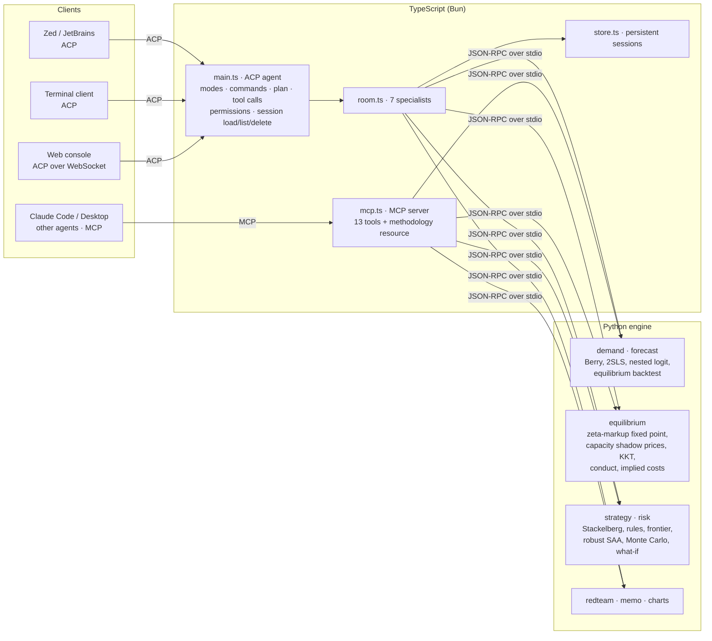

# Decision Room

**A pricing war room for producers in concentrated markets. It runs inside your editor over the Agent Client Protocol (ACP), and inside other agents over MCP.**

**[Watch a recorded session in your browser ↗](https://apex1s.github.io/decision-room/)**: the real agent on the synthetic demo market, played back as it streamed over ACP. No install needed.

Ask *"What should we charge next quarter?"* in Zed, JetBrains or any ACP client. Seven specialist agents work through the answer, each shown live as a tool call:

- A **data steward** checks the market panel.
- A **demand economist** picks and validates the demand model.
- A **game theorist** solves the competitive equilibrium and tests whether rivals really compete.
- A **strategist** sets our prices by region and grade while anticipating rivals, and prices our own commercial rules.
- A **risk analyst** runs what-ifs and simulated futures.
- A **red team** attacks the recommendation.
- A **memo writer** hands over a board memo.

Every number comes from an econometrics and optimisation engine, never from a language model.

```
you › What does it cost us if no region may take more than 22% of our volume?

◐ Strategist: Pricing the commercial-security rule [execute]
  • Pricing the rule: optimum with and without it, then one point tighter
  ✓ done

Rule priced: no region above 22% of our volume.
- Profit without the rule: $137.61M per quarter; with it: $136.36M.
- The rule costs $1.25M per quarter (0.91% of profit), about $5.00M a year.
- One more point of tightening would cost a further $0.56M per quarter.
```

## Why this exists

In oligopolies (phosphate, potash, cement, steel, LNG, shipping), prices and market shares are not inputs: rivals answer every move you make. Spreadsheets ignore the answer, and generic AI copilots invent numbers. Decision Room models the answer and refuses to invent anything:

| | Spreadsheet model | LLM copilot | **Decision Room** |
|---|---|---|---|
| Rivals react to your price | no | no | **yes** (capacity-constrained Bertrand-Nash, Stackelberg leader) |
| Demand estimated without bias | rarely | no | **yes** (Berry inversion, 2SLS, nested logit chosen on evidence) |
| Checks whether rivals really compete | no | no | **yes** (conduct test: competition, collusion or price = cost) |
| Validated out of sample | rarely | no | **yes** (forecasts the whole next-quarter equilibrium vs a naive benchmark) |
| Prices your own rules, decides under uncertainty | no | no | **yes** (constraint frontier, robust sample-average optimisation) |
| Tells you when not to trust it | no | no | **yes** (13-check red team, A–D grade, stated limits) |
| Lives where analysts work | Excel | chat tab | **any ACP editor, any MCP agent**, terminal or browser |

## Results on the demo market

The demo market is synthetic: four fictional producers, three grades, six regions and 40 quarters, with known true parameters. Its buyers substitute mostly within a grade (nested logit, σ = 0.45). Prices in it are generated by the equilibrium itself, so they are endogenous, as in real data.

- **The engine finds the right model.** Nested logit is selected over plain logit on evidence. Its 95% intervals contain the true price sensitivity and nesting parameter on all 5 independent synthetic markets tested. Plain logit would overstate price sensitivity by 68%, and plain OLS would be 50% off.
- **It forecasts.** Forecasting each of the last 8 quarters' full equilibrium without seeing that quarter's demand shock, it beats "same as last quarter" by 14% on shares and 32% on prices, and gets the direction of price moves right 85% of the time.
- **It reads conduct.** Observed prices fit Bertrand competition (1.2% gap to stated costs), not collusion (145%) or price = cost (53%).
- **It decides.** The recommendation adds $6.97M per quarter (+5.3%) over keeping last quarter's prices, wins in 99% of 200 simulated futures, and comes with prices for every grade in every region.
- **It is honest.** Every equilibrium is certified by KKT conditions to about 1e-11 $/t. The red team still grades the decision **B, not A**, because a third of the recommended prices lie above anything in the price history.

## What is inside



- **ACP all the way:**
  - Session modes (Advisor or Autopilot) and 16 slash commands.
  - A live plan, with each specialist shown as a tool call that streams progress and attaches its chart.
  - Permission before writing files, and the memo shown as a diff.
  - Attached CSV folders become the market.
  - Cancellation.
  - **Persistent sessions:** `session/list`, `session/load` with full replay and the engine state restored, and `session/delete`.
- **MCP too:** the same specialists are exposed as tools, so Claude Code or any MCP client can call `recommend_prices`, `what_if`, `test_conduct` or `red_team` directly.
- **Works offline:** no API key needed. With `ANTHROPIC_API_KEY` set, Claude routes free-form questions and writes a short executive summary using only the figures the engine computed.
- **Bring your own data:** five CSV files plus optional quarterly capacities ([docs/DATA.md](docs/DATA.md)).

## Run it

Requirements: Python 3.11+ with `numpy` and `scipy`, and [Bun](https://bun.sh) 1.1+.

```bash
pip install -r engine/requirements.txt
```

```bash
cd agent && bun install
```

| Command (in `agent/`) | What it does |
|---|---|
| `bun run web` | Browser console on http://localhost:4317: specialist cards, live plan, inline charts, rooms you can reopen |
| `bun run demo` | Scripted 4-question demo in the terminal |
| `bun run chat` | Interactive terminal chat |
| `bun run agent` | The ACP agent itself (what editors launch) |
| `bun run mcp` | The MCP server |
| `bun run site` | Re-records the demo session into `site/` (the GitHub Pages replay) |

In **Zed** (Agent Panel → External Agents → Add Custom Agent), or in `settings.json`:

```json
{
  "agent_servers": {
    "Decision Room": { "type": "custom", "command": "bun", "args": ["/absolute/path/to/decision-room/agent/src/main.ts"] }
  }
}
```

In **Claude Code**:

```bash
claude mcp add decision-room -- bun /absolute/path/to/decision-room/agent/src/mcp.ts
```

Full editor and agent setup: [docs/EDITORS.md](docs/EDITORS.md). The engine also runs alone: `cd engine && python -m decision_room demo --out ../out/demo` writes the full memo.

## Proof it works

```bash
cd engine && python -m pytest -q
```

That runs 21 tests:
- **Equilibrium:** KKT certification and uniqueness at three nesting levels, the logit closed form, finite-difference profit optimality, and exact inversion of implied costs.
- **Demand:** truth recovery on 3 markets, OLS and logit bias, model selection, and the forecast beating both naive and logit.
- **Strategy:** leader profit ≥ Nash, a monotone frontier, the robust plan winning on its own worlds, the what-if, and the conduct test.
- **Plumbing:** the CSV round trip (including `settings.json`, extra instruments and annual wording) and JSON-RPC.

```bash
cd agent && bun test
```

That runs 9 tests:
- The intent parser.
- ACP end to end: a priced rule, attached data, cancellation, and a session that survives the agent process (list, load with replay, continue, delete).
- The MCP server called with the official MCP client.

CI runs both suites on every push ([.github/workflows/ci.yml](.github/workflows/ci.yml)).

## Documents

- [docs/PITCH.md](docs/PITCH.md): the product and business case
- [docs/ARCHITECTURE.md](docs/ARCHITECTURE.md): ACP, MCP, the agent and the engine
- [docs/METHODOLOGY.md](docs/METHODOLOGY.md): the economics, with every assumption stated
- [docs/EDITORS.md](docs/EDITORS.md): Zed, JetBrains, Claude Code and other clients
- [docs/DATA.md](docs/DATA.md): bring your own market data
- [docs/demo-transcript.txt](docs/demo-transcript.txt): a full recorded session

## Origin

Decision Room grew out of my experience in commodity pricing. It is built entirely on published methods (Berry 1994, Bertrand-Nash and Stackelberg competition, sample-average optimisation) and runs on a synthetic market whose producers are fictional. It contains no third-party or company data.

Built by **Anas Sabbahi**, industrial management engineer (EMINES, UM6P), data science track · [github.com/Apex1s](https://github.com/Apex1s)
