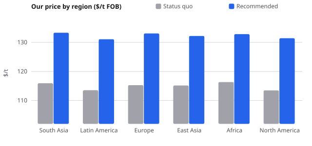
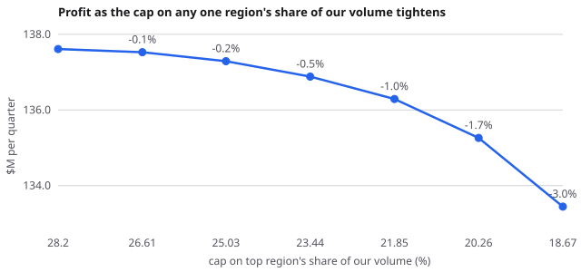
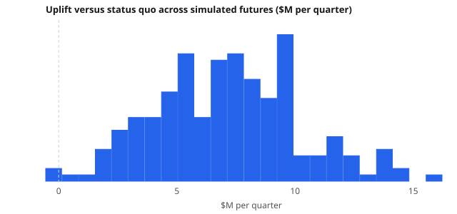
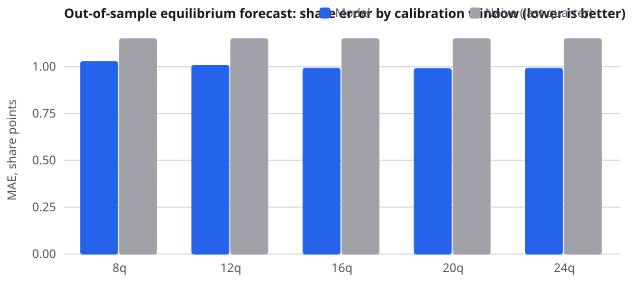

# Decision memo: Atlas pricing, next quarter

*Data: synthetic demo (fictional producers, known ground truth). 40 quarters, 1,840 observations, 4 producers, 6 regions.*

## The decision

Reprice Atlas region by region: $7.0M per quarter versus keeping last quarter's prices (+5.3%), winning in 99.0% of simulated futures. Red-team grade B.

| Region | Status quo $/t | Recommended $/t | Move | Volume Mt | Share of our volume |
|---|---:|---:|---:|---:|---:|
| South Asia | 115.8 | 133.2 | +17.4 | 0.707 | 28.2% |
| Latin America | 113.5 | 131.0 | +17.5 | 0.516 | 20.6% |
| Europe | 115.2 | 133.0 | +17.8 | 0.436 | 17.4% |
| East Asia | 115.1 | 132.1 | +17.0 | 0.354 | 14.1% |
| Africa | 116.3 | 132.7 | +16.5 | 0.244 | 9.7% |
| North America | 113.4 | 131.3 | +17.9 | 0.249 | 9.9% |

| Outcome per quarter | Status quo | Nash | Recommended |
|---|---:|---:|---:|
| Profit | $130.64M | $130.54M | $137.61M |
| Volume | 3.454 Mt | 3.466 Mt | 2.506 Mt |
| Capacity used | 85.9% | 86.2% | 62.3% |
| Market share | 25.51% | 25.59% | 18.50% |
| Largest region, % of our volume | 28.1% | 28.2% | 28.2% |

## What the commercial-security rule costs

| Cap on top region | Profit $M | Given up | Marginal cost per point $M |
|---:|---:|---:|---:|
| 28.2% | 137.61 | 0.00% |  |
| 26.6% | 137.53 | 0.06% | 0.053 |
| 25.0% | 137.29 | 0.23% | 0.151 |
| 23.4% | 136.88 | 0.53% | 0.256 |
| 21.9% | 136.29 | 0.96% | 0.373 |
| 20.3% | 135.26 | 1.71% | 0.647 |
| 18.7% | 133.44 | 3.03% | 1.143 |

## Risk

200 joint draws of demand parameters, next-quarter demand shocks and market sizes; rivals re-optimise in every draw.

- Recommended beats status quo in **99.0%** of draws.
- Uplift P10 / P50 / P90: +3.04 / +7.14 / +10.90 $M per quarter. Worst draw: -0.55.
- Profit P10 / P50 / P90 if we act: 127.8 / 139.1 / 150.7 $M.

## How we know

- **Demand:** 2SLS nested logit by grade (Berry inversion, SEs clustered by product-region). Price sensitivity 0.0209 per $/t (95% CI 0.0177 to 0.0241), within-grade nesting sigma 0.48 (95% CI 0.41 to 0.56); first-stage F = 1354.9. Plain OLS would have been -49.6% off.
- **Model choice:** nested logit selected because nesting is significant (sigma 0.48) and nested logit forecasts better out of sample (0.989 vs 1.072 share pts).
- **Validation:** for each of quarters 33 to 40, the engine forecast the whole equilibrium (prices and shares) without seeing that quarter's demand shock. Share error 0.99 pts vs 1.15 for "same as last quarter"; price error 1.80 $/t vs 2.64 naive, price direction right 85% of the time.
- **Conduct:** Observed prices fit Bertrand competition best: stated vs implied costs differ by 1.2% under Bertrand, 145.3% under collusion, 52.9% under perfect competition (firms with spare capacity: Atlas, Cerro).
- **Competition:** capacity-constrained Bertrand-Nash among rivals (zeta-markup fixed point for nested logit, outer subgradient on capacity shadow prices), certified by KKT conditions. Rivals at capacity: Boreal, Cerro, Dune.
- **Our move:** Stackelberg leader: we commit to regional price levels (grade spreads kept at their competitive structure) anticipating rivals' response.

## Red team: grade B

Usable, with the caveat flagged below.

| Check | Result | Evidence |
|---|---|---|
| Instrument strength | PASS | First-stage F for price = 1355, within-nest share F = 360 (rule of thumb: > 10). |
| Endogeneity correction | PASS | OLS price sensitivity is -49.6% off the instrumented one; using OLS would have overstated optimal markups. |
| Price sensitivity identified | PASS | alpha = 0.0209, 95% CI [0.0177, 0.0241] (SEs clustered by product-region). |
| Substitution pattern | PASS | Nested logit by grade, sigma = 0.48 (95% CI from 0.41): buyers substitute mostly within a grade. Plain logit would put price sensitivity +68% off and misprice every grade. |
| Parameter stability | PASS | alpha first half 0.0217 vs second half 0.0196 (10% apart). |
| Out-of-sample skill | PASS | Window 20 periods: share MAE 0.99 pts vs naive 1.15 (+14.0% skill), direction right 65% of 350 moves. |
| Pricing on the elastic side | PASS | Our own-price elasticities range -4.63 to -3.54 (a profit-maximiser never prices where |e| < 1). |
| Market conduct | PASS | Observed prices fit Bertrand competition best: stated vs implied costs differ by 1.2% under Bertrand, 145.3% under collusion, 52.9% under perfect competition (firms with spare capacity: Atlas, Cerro). |
| Equilibrium certified (KKT) | PASS | Nash stationarity 1.9e-11 $/t, complementarity 2.7e-07; follower response stationarity 1.3e-11 $/t. |
| Rivals' response is unique | PASS | 6 random restarts land within 8.6e-06 $/t. |
| Inside the data | WARN | Recommended prices span 112-151 $/t; history spans 87-133. 33% of recommended prices extrapolate. |
| Robust to uncertainty | PASS | Beats the status quo in 99.0% of 200 joint draws (parameters, demand shocks, market sizes); P10 uplift +3.04 $M. |
| Ground truth recovered | PASS | True alpha 0.0220 is inside the 95% CI; true sigma 0.45 is inside [0.41, 0.56]. (Available only on synthetic data.) |

## What this model cannot tell you

- Substitution follows the nest structure (grades). Buyers who would switch region rather than grade, or long-term offtake contracts, are not represented.
- The game is static, one quarter at a time. Long-term contracts, retaliation and reputation are not modelled.
- Marginal costs and capacities are taken from the input files. The engine checks them against prices but cannot verify them.
- The conduct test compares three textbook behaviours. Partial collusion or tacit regional splits sit between them and would need a richer test.

*Generated by Decision Room. Every number above was computed by the engine, not written by a language model.*
